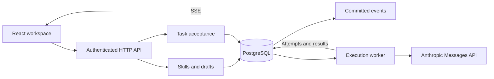

# Skill Library

**Improve your agent’s skills. Keep your teammates’ edits. Know exactly what ran.**

A shared workspace for teams that build and maintain AI agent skills: reusable instructions and supporting text resources. Create, review changes, publish immutable versions, and trace task results back to the exact skills used.

[中文介绍](README.zh-CN.md) · [How it works](#how-it-works) · [Get started](#get-started) · [Deployment guide](docs/deployment/runbook.md)

## The problem

A skill starts as a useful prompt. Then a second person edits it, a running task depends on it, and “just update the file” becomes risky.

- A teammate publishes while you are still editing. Which changes survive?
- An agent produces a different result after an update. Which instructions did it actually use?
- A request times out. Did it fail, or did the model finish and charge for it?

Skill Library makes these situations visible and recoverable.

| When this happens… | Skill Library helps you… |
| --- | --- |
| Someone publishes while you are writing | Keep unsaved input, see the update, and compare your draft with the base and latest version. |
| Your draft is behind the published version | Explicitly reconcile changes before publishing. Stale drafts are rejected by the server. |
| A skill changes during a task | Keep that task, its retries, and its children on their original version snapshot. New tasks use the latest version by default. |
| A remote execution becomes uncertain | Inspect the attempt and provider request ID when available, then make an informed retry decision. |
| A teammate leaves | Recheck access on requests and event streams, and close the old workspace when access is revoked. |

## One workflow, from draft to result

1. **Build a shared library.** Create a team, invite collaborators, and assign admin, contributor, or viewer roles.
2. **Edit in your own draft.** Recover saved drafts, update metadata, and add supporting text files.
3. **Publish with confidence.** Valid, current drafts become new versions immediately. Teammates receive updates without having their input replaced.
4. **Resolve changes deliberately.** Compare base, local, and published content; confirm how to combine changes. Restore an older version by creating a new draft.
5. **Follow the execution.** Inspect the selected skills, fixed versions, execution attempts, result, and failure state in one task view.

## Built for changes that matter

Consider two teammates editing the same research skill:

- Both start from **v1**. One publishes **v2** while the other is still writing.
- The second teammate sees the update, keeps their input, and reconciles the differences before publishing **v3**.
- A task already accepted on **v1** continues using **v1**, including retries and child tasks.
- A new task picks up **v3** by default.

The team can keep improving the skill while every task retains a clear record of the instructions it used.

<details>
<summary><strong>See the collaboration workflow</strong></summary>


Compare the base version, your edits, and the latest published content before applying an update. Shown with sample data in the Chinese interface.

</details>

## How it works

A **TypeScript modular monolith** with React, Node.js, PostgreSQL, and Server-Sent Events. Identity, skill management, and execution share one database and one connection pool.



Two transaction boundaries protect the product’s most important promises:

- **Publishing:** permission, revision, and base-version checks commit together with the immutable version, current-version pointer, updated draft, audit entry, event, and idempotency receipt.
- **Accepting a task:** the fixed version snapshot and queued execution request commit together. The external model call happens afterward, outside the transaction.

Concurrent publication from the same base has one winner. The other author keeps their draft. Execution uses bounded attempts and leases; a timed-out call that may have reached the provider becomes `uncertain` instead of being silently retried.

The application is designed for a single app instance backed by persistent PostgreSQL. Team-level locking gives publication and task acceptance a defined order. Model execution uses the configured Anthropic model to generate text from the selected skill resources, without shell or tool access.

Explore the [database design and migrations](src/modules/persistence/README.md), [execution state machine](src/modules/execution/README.md), and [deployment runbook](docs/deployment/runbook.md).

## Get started

Self-host Skill Library with **Node.js 24+ and PostgreSQL 17+**. Configure an HTTPS origin and a GitHub OAuth app for your workspace. The [deployment guide](docs/deployment/runbook.md) covers Docker Compose, secrets, backups, and monitoring.

From the repository root:

```sh
sh src/deployment/install.sh
npm run build --prefix src/modules/product

# After configuring the server environment:
npm run start:production --prefix src
```

| Configuration | Purpose |
| --- | --- |
| `DATABASE_URL` | PostgreSQL connection |
| `PUBLIC_ORIGIN` | Workspace HTTPS origin |
| `GITHUB_CLIENT_ID`, `GITHUB_CLIENT_SECRET` | GitHub sign-in; callback is `PUBLIC_ORIGIN/api/identity/callback` |
| `METRICS_TOKEN` | Private monitoring endpoint credential |
| `EXECUTION_ENABLED=true`, `ANTHROPIC_API_KEY`, `EXECUTION_MODEL` | Enable model execution with your provider account |

Keep credentials on the server. Secret-file configuration and optional Anthropic workspace selection are documented in the deployment guide.

Once the server is running, sign in, create a team, and publish your first skill. Invite a teammate to collaborate, or select a published skill to create a task.

## Code map

| Location | Responsibility |
| --- | --- |
| `src/modules/product` | Workspace, skill management, and author-controlled updates |
| `src/modules/identity` | OAuth, revocable sessions, invitations, and team permissions |
| `src/modules/persistence` | SQL migrations, constraints, repositories, and transaction boundaries |
| `src/modules/broadcast` | Authenticated HTTP/SSE and durable event replay |
| `src/modules/execution` | Provider adapter, attempts, cancellation, recovery, and task UI |
| `src/modules/operations` | Configuration, limits, telemetry, and restore drills |
| `src/integration` · `src/deployment` | Application composition, release checks, and deployment |
